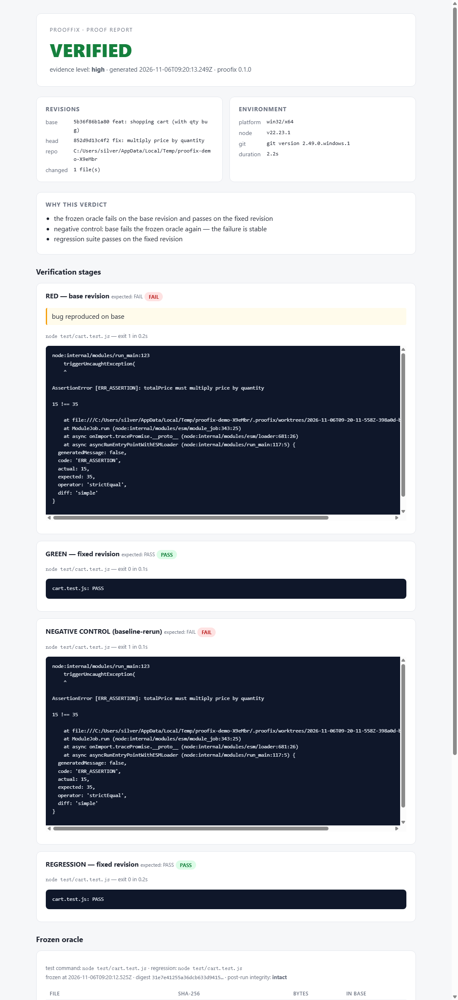

# ProofFix

**Your AI fixed the bug. Now prove it.**

ProofFix is an open-source, local-first verification tool for coding agents. When an AI says "the bug is fixed", ProofFix *executes* the evidence:

- checks out the buggy base and the candidate fix in **isolated git worktrees**,
- freezes the acceptance tests into a **SHA-256 oracle** (persisted at `.proofix/oracle.json` with an append-only audit log in `oracle-history.jsonl`) so the fix can't pass by editing, deleting or skipping tests — and a changed test surface is always flagged as a re-baseline,
- requires **RED on base → GREEN on head**, then runs a **negative control** and an optional **regression suite**,
- emits a machine-readable JSON report + a self-contained HTML **Proof Report**.

No API keys. No cloud. The verdict comes from running your tests, never from asking a model.

## Why

Coding agents confidently report "fixed" — but without an independent check, "fixed" can mean the code changed, the test was weakened, or the failure was never reproducible. ProofFix's job is narrow on purpose: it doesn't write code, it **proves a claimed fix** with reproducible evidence.

## Quick start

```bash
npm i -g @proofix/cli        # or: pnpm add -g @proofix/cli

proofix demo                  # self-contained buggy→fixed repo, full verification

cd your-repo
proofix init                  # writes .proofix.yml
proofix verify \
  --base HEAD~1 \             # revision that contains the bug
  --head HEAD \               # revision claiming the fix
  --test "node test/cart.test.js" \
  --regression "pnpm test"    # optional broader suite
```

Open the report: `proofix report --open`.



## Verdicts

| Verdict | Meaning |
|---|---|
| `VERIFIED` | Oracle fails on base, passes on head, negative control holds |
| `FAILED` | Fix doesn't pass the oracle, oracle was tampered with, or it caused a regression |
| `INCONCLUSIVE` | Bug not reproducible / flaky or vacuous tests — honest "can't prove it" |
| `ERROR` | Environment/setup broke (missing tools, failed installs) — never counts as fixed |
| `NEEDS_REVIEW` | Evidence exists but the fix touched its own acceptance tests — a human must look |

Confidence (`evidence: high|medium|low`) drops automatically when the negative control or regression stage is unavailable.

## How it verifies

```
base worktree  ──► run frozen oracle ──► must FAIL        (bug reproduced)
head worktree  ──► run frozen oracle ──► must PASS        (fix works)
head worktree  ──► re-hash oracle    ──► must be INTACT   (no test tampering)
base worktree  ──► negative control  ──► must FAIL again  (stable red signal
                 or transplanted oracle fails on base      / vacuous-test check)
head worktree  ──► regression suite  ──► must PASS        (optional, recommended)
```

Anything ambiguous degrades to `INCONCLUSIVE`/`ERROR` — ProofFix never upgrades weak evidence to `VERIFIED`.

## Risk-aware review

ProofFix classifies every file the fix touches — auth, permissions, payments, migrations, secrets, CI/CD, dependencies — into `low`/`medium`/`high` risk. A `VERIFIED` verdict on a **high-risk** surface is downgraded to `NEEDS_REVIEW`: ProofFix attaches the evidence but never auto-approves merges or deploys on sensitive code.

## Safety

- Test commands run **only inside dedicated git worktrees** under `.proofix/worktrees`, never in your working tree.
- Subprocess env is **scrubbed**: `*TOKEN*`, `*SECRET*`, `*KEY*`, `*PASSWORD*` vars are stripped unless explicitly allowed via `passEnv`.
- Every command has a timeout. No pushes, no global git config changes, no uploads — everything stays on disk.
- For untrusted third-party repos, run ProofFix itself inside a container/VM; see [SECURITY.md](SECURITY.md).

## DeepSeek Harness plugin

`packages/dsh-plugin` is a native Cordis plugin exposing `proofix_verify` and `proofix_report` tools. The agent that proposed the fix can *request* verification but cannot influence the verdict — the frozen oracle is evaluated by an independent engine.

```bash
dsh plugin add @proofix/dsh-plugin
```

Tools exposed: `proofix_verify` (independent check), `proofix_report` (latest report), `proofix_autofix` (bounded verify-and-feedback loop — max 3 rounds per session, then hands off to the human). The agent proposing the fix can *request* verification but cannot influence the verdict or the round counter.

Install verified end-to-end on DSH `0.2.2-rc.1` via `dsh plugin --profile <name> add <tarball>`; type-checked against `@deepseek-ai/cordis ^4`. The Cordis API is pre-1.0 — pin versions.

## Repo layout

```
packages/core        verification engine (zero-dependency, agent-agnostic)
packages/cli         proofix command-line interface
packages/dsh-plugin  DeepSeek Harness Cordis plugin
docs/                research, decisions, verification log
```

## Platform support

Tested on Windows 11 (Node 22, git 2.49). macOS/Linux use the same `git worktree` + `/bin/sh` paths and are expected to work; CI covers all three.

## License

MIT — see [LICENSE](LICENSE). 中文文档：[README.zh-CN.md](README.zh-CN.md)
